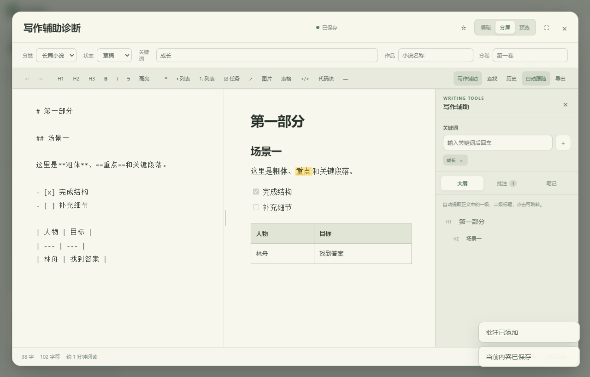

# 写作空间 Writing Space

一款本地优先的桌面写作工具，用统一工作区管理正文、素材、大纲、批注、写作笔记和历史版本。AI在这里承担审校与问题提示，作者始终保留观点、文风和最终修改权。

## 为什么开发

长文写作的难点不只是生成文字，还包括长期维护文章结构、素材来源、人物设定、批注和不同版本。普通聊天式工具容易让素材与正文散落，也可能在反复生成中削弱作者原有的表达。

写作空间希望解决两个问题：

- 把写作过程放进一个可以长期维护的本地工作区。
- 让AI帮助发现错误和结构问题，但不直接替作者做决定。

## 核心功能

- **多类型写作管理：**支持长篇小说、短篇文章、日常随笔、读书笔记及自定义分类。
- **沉浸式编辑：**提供编辑、分屏和预览布局，支持Markdown实时预览与长文本跟随。
- **写作辅助：**集中管理关键词、大纲、正文批注和不会混入正文的私人笔记。
- **AI审校：**检查错别字、语病、标点、措辞、段落结构和内容一致性。小说模式还会检查人物动机、事件链、伏笔与节奏。
- **人工确认：**AI建议可逐条选择，程序只应用能够准确定位且由用户确认的修改。
- **版本与恢复：**保留文章历史版本，支持回收站、本地备份与恢复。
- **文档兼容：**支持Markdown、TXT、Word和文本型PDF导入，可导出Markdown、TXT、HTML、Word及PDF。
- **多设备同步：**可通过用户自行选择的OneDrive、坚果云等本地同步文件夹交换文章更新，并在并发编辑时保留冲突副本。
- **本地优先：**正文、批注、笔记和设置默认保存在本机；只有用户主动启动AI审校时，当前文章内容才会发送至DeepSeek接口。

## 产品原则

1. **作者拥有最终决定权。** AI是编辑和校验者，不是作者。
2. **建议必须可核验。** 自动修改前核对原文与上下文，正文变化后停用过期建议。
3. **数据边界清晰。** 写作数据默认保存在本地，API Key不写入源码或文章数据。
4. **从真实写作流程出发。** 功能围绕素材、结构、版本和复盘设计，而不是单纯增加生成入口。

## 技术栈

- Electron 30
- JavaScript、HTML、CSS
- DeepSeek API
- docx、mammoth、pdfjs-dist、turndown

## 本地运行

要求：Node.js 18或更高版本。

~~~bash
npm install
npm start
~~~

运行AI审校前，需要在“设置与数据”中填写自己的DeepSeek API Key。仓库不包含任何预设密钥。

## 代码检查与构建

~~~bash
npm run check
npm run build:win
~~~

生成Windows安装程序：

~~~bash
npm run build:win:installer
~~~

在macOS上构建Apple Silicon版本：

~~~bash
npm run build:mac
~~~

构建产物位于 dist/，不会提交到Git仓库。可执行程序通过GitHub Releases单独发布。

## 隐私说明

- 文章正文、批注、写作笔记、历史版本和统计数据默认存放在本机应用数据目录。
- 临时API Key只保存在当前进程内存中，退出后清除。
- 用户主动选择“加密保存”时，程序使用Electron提供的系统安全存储能力保存密钥。
- 多设备同步依赖用户自己的网盘客户端和本地同步文件夹，不经过本项目自建服务器。
- 同步文件没有额外的端到端加密，请仅使用个人私有网盘目录。

更完整的说明见 [PRIVACY.md](PRIVACY.md)。

## 当前版本

v0.9.6

Windows版本基于Electron 30.5.1构建。未经代码签名的安装包可能触发Windows SmartScreen提示，请核对Release页面提供的SHA-256后再运行。

## 项目状态

这是个人独立开发项目，目前持续用于真实写作场景。欢迎通过Issue反馈问题和改进建议。

## 许可

源码公开用于作品展示、学习和非商业评估。未经书面许可，不得复制、修改、分发或用于商业用途，详见 [LICENSE](LICENSE)。
